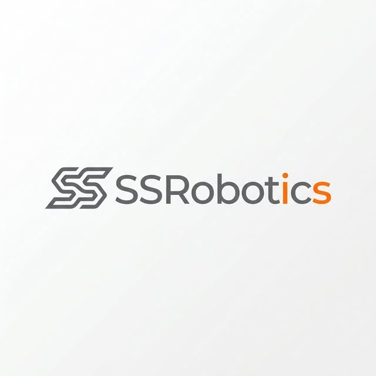

<p align="center"></p>

<h1 align="center">⚙️ Whole-body Control</h1>
<p align="center"><b>SSRobotics · Source Code Collection</b></p>

<p align="center">
  <a href="https://ssrobotic.github.io/humanoid-robot-hub/"></a>
  <a href="https://ssrobotic.github.io/humanoid-robot-hub/"></a>
  <a href="https://github.com/SSRobotic/humanoid-robot-hub/blob/main/CREDITS.md"></a>
</p>


**Part of [Humanoid Robot Hub](https://github.com/SSRobotic/humanoid-robot-hub)** · [🔎 Search all resources](https://ssrobotic.github.io/humanoid-robot-hub/)

Dynamics, kinematics, locomotion and whole-body control references.

Dynamics, Kinematics, Locomotion และการควบคุมทั้งร่างกาย

Curated by **SSRobotic — Robotics Engineer & Open-source Curator**. This repository is a focused resource directory and engineering guide. Linked SDKs, models and research implementations belong to their original creators.

## 🗂️ Resource directory

| Resource | What it provides | Keywords | Original source |
| --- | --- | --- | --- |
| [Pinocchio](https://github.com/stack-of-tasks/pinocchio) | Rigid-body dynamics and kinematics algorithms for robotics, including model-based control research. | Kinematics, Dynamics, C++ | [stack-of-tasks](https://github.com/stack-of-tasks/pinocchio) |
| [Drake](https://github.com/RobotLocomotion/drake) | Model-based robotics toolbox for dynamics, optimization, planning and control. | Dynamics, Optimization, Planning | [RobotLocomotion](https://github.com/RobotLocomotion/drake) |
| [OpenLoong Dynamics Control](https://github.com/loongOpen/OpenLoong-Dyn-Control) | OpenLoong humanoid dynamics and control framework with simulation resources. Follow its supported model and environment. | Humanoid, Whole-body control, MuJoCo | [loongOpen](https://github.com/loongOpen/OpenLoong-Dyn-Control) |
| [TienKung ROS](https://github.com/Open-X-Humanoid/TienKung_ROS) | TienKung ROS software and hardware-control modules. | TienKung, ROS, Control | [Open-X-Humanoid](https://github.com/Open-X-Humanoid/TienKung_ROS) |
| [Deploy TienKung](https://github.com/Open-X-Humanoid/Deploy_Tienkung) | Deployment code and platform-specific interfaces for TienKung workflows. | TienKung, Deployment, C++ | [Open-X-Humanoid](https://github.com/Open-X-Humanoid/Deploy_Tienkung) |
| [TSID](https://github.com/stack-of-tasks/tsid) | Task-space inverse-dynamics control using Pinocchio, with robotics exercises and examples. | Inverse dynamics, Whole-body control, QP | [stack-of-tasks](https://github.com/stack-of-tasks/tsid) |
| [Crocoddyl](https://github.com/loco-3d/crocoddyl) | Contact-aware optimal control with DDP-family solvers for robot motion. | DDP, Optimal control, Contacts | [loco-3d](https://github.com/loco-3d/crocoddyl) |
| [OCS2](https://github.com/leggedrobotics/ocs2) | Optimal-control and MPC tooling for systems with switching dynamics. | MPC, Optimal control, Switched systems | [leggedrobotics](https://github.com/leggedrobotics/ocs2) |
| [Pink Inverse Kinematics](https://github.com/pink-kinematics/pink) | Differential inverse kinematics in Python using Pinocchio and QP solvers. | IK, Pinocchio, QP | [pink-kinematics](https://github.com/pink-kinematics/pink) |
| [OSQP](https://github.com/osqp/osqp) | Numerical solver for convex quadratic programs, useful as a component in IK and control formulations. | QP, Optimization, Solver | [osqp](https://github.com/osqp/osqp) |
| [CasADi](https://github.com/casadi/casadi) | Symbolic differentiation and optimization tools for formulating nonlinear control and trajectory problems. | NLP, Automatic differentiation, MPC | [casadi](https://github.com/casadi/casadi) |

## 📦 Code & models in this repository

**319 tracked upstream files** — เปิดโฟลเดอร์ด้านล่างเพื่อดูโค้ดจริง โมเดล และตัวอย่างต้นฉบับ

| Project files | Files | Pinned source | License / notices |
| --- | ---: | --- | --- |
| [stack-of-tasks/tsid](projects/tsid) | 319 | [`25762a26464d`](https://github.com/stack-of-tasks/tsid/tree/25762a26464d10f6a2b1becc87f6e9a13c24c44b) | [LICENSE](projects/tsid/LICENSE) |

[Source manifest](source-manifest.json) records commits, file counts, Git LFS pointers and external submodules. [Per-file manifests](source-manifests/) record original Git blob hashes. `projects/` keeps upstream code, README files, licenses and notices; SSRobotics supplies the organization and guides.

```bash
git clone --depth 1 https://github.com/SSRobotic/humanoid-whole-body-control.git
cd humanoid-whole-body-control
```

Open the imported project README for its dependencies, build instructions and supported robot/simulator versions. Each snapshot is collected independently; these projects have not been validated as one combined runnable stack.

## 🚀 Start here

1. Start with a consistent robot model, state representation and actuator interface.
2. Study the source project’s kinematics, dynamics and controller assumptions.
3. Evaluate the documented controller in its simulator before considering hardware integration.

Read the [engineering guide](GUIDE.md) for a practical selection checklist. [resources.json](resources.json) contains the structured entries.

## 🔗 Explore the ecosystem

<details>
<summary>🌐 Browse all 14 categories</summary>

[🦾 Models & URDF](https://github.com/SSRobotic/humanoid-models) · [🌐 Simulation](https://github.com/SSRobotic/humanoid-simulation) · [🧠 Robot Learning](https://github.com/SSRobotic/humanoid-robot-learning) · [⚙️ Whole-body Control](https://github.com/SSRobotic/humanoid-whole-body-control) · [👁️ Vision & 3D Perception](https://github.com/SSRobotic/humanoid-vision) · [🤏 Manipulation & Planning](https://github.com/SSRobotic/humanoid-manipulation) · [🎮 Teleoperation](https://github.com/SSRobotic/humanoid-teleoperation) · [💾 Datasets & Demonstrations](https://github.com/SSRobotic/humanoid-datasets) · [💬 Vision-Language-Action](https://github.com/SSRobotic/humanoid-vla) · [🔌 Hardware & SDKs](https://github.com/SSRobotic/humanoid-hardware-sdks) · [📡 ROS & Integration](https://github.com/SSRobotic/humanoid-ros2) · [📚 Research & Benchmarks](https://github.com/SSRobotic/humanoid-research) · [🟢 Isaac Sim & Isaac Lab](https://github.com/SSRobotic/humanoid-isaac-sim) · [🧮 Robotics Algorithms](https://github.com/SSRobotic/humanoid-algorithms)

</details>

[🏠 Main Hub](https://github.com/SSRobotic/humanoid-robot-hub) · [🤖 Profile](https://github.com/SSRobotic)

## 🙌 Help this collection grow

⭐ [Star the Hub](https://github.com/SSRobotic/humanoid-robot-hub) · 👤 [Follow SSRobotic](https://github.com/SSRobotic) · 💡 [Suggest a resource](https://github.com/SSRobotic/humanoid-robot-hub/issues/new/choose)

Contribute accurate descriptions and original source links through the [Hub contribution guide](https://github.com/SSRobotic/humanoid-robot-hub/blob/main/CONTRIBUTING.md). Source terms, model compatibility and dataset access conditions remain with each upstream project.
